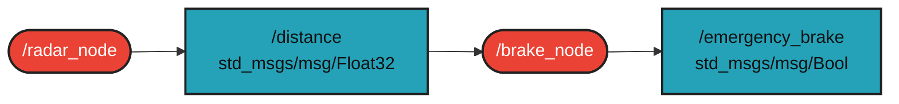

# `mes_ob9_fekrendszer` package

ROS 2 C++ package. 

A package két node-ból áll. A `/radar_node` folyamatosan csökkenő távolságadatokat szimulál egy akadály felé közeledve, amit a `/distance` nevű `std_msgs/msg/Float32` topicban hirdet. A `/brake_node` feliratkozik erre a topicra, és amennyiben a távolság 2.0 méter alá esik, vészfékezési jelzést hirdet az `/emergency_brake` nevű `std_msgs/msg/Bool` topicban, valamint figyelmeztetést jelenít meg a terminálban. Megvalósítás `ROS 2 Humble` alatt.

## Packages and build

It is assumed that the workspace is `~/ros2_ws/`.

### Clone the packages

```bash
cd ~/ros2_ws/src
```

```bash
git clone [https://github.com/markoo0120/mes_ob9_fekrendszer](https://github.com/markoo0120/mes_ob9_fekrendszer)
```

### Build ROS 2 packages

```bash
cd ~/ros2_ws
```

```bash
colcon build --packages-select mes_ob9_fekrendszer --symlink-install
```

<details>
<summary>Don't forget to source before ROS commands.</summary>

```bash
source ~/ros2_ws/install/local_setup.bash
```
</details>

```bash
ros2 launch mes_ob9_fekrendszer fekrendszer.launch.py
```

```bash
ros2 run mes_ob9_fekrendszer radar_node
```

```bash
ros2 run mes_ob9_fekrendszer brake_node
```

## Graph

